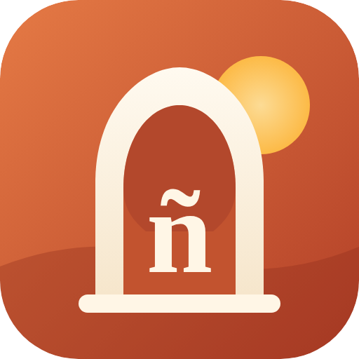

<p align="center"></p>

<h1 align="center">¡Vamos! — испанский с нуля</h1>

<p align="center">Приложение для изучения испанского для русскоговорящих: подробные объяснения грамматики, 12 типов упражнений, диалоги, словарь с интервальным повторением, разбор фильмов по субтитрам, справочник диалектов и ИИ-преподаватель.<br>Работает в браузере и устанавливается на телефон (PWA, работает офлайн).</p>

## Возможности

- **Курс A1 и начало A2** — 27 уроков: теория по шагам, примеры с разбором по словам, типичные ошибки русскоговорящих, упражнения от простых к сложным, повторение и проверка.
- **12 типов упражнений** — выбор перевода, перевод в обе стороны, сборка фраз, пропуски, исправление ошибок, сопоставление, аудирование и диктант, диалоги, ситуации.
- **8 диалогов** с персонажами из Испании, Мексики и Аргентины + свободный разговор с ИИ.
- **Словарь** с интервальным повторением (SM-2), избранным и сверкой переводов.
- **Видео и фильмы** — загрузка видео и субтитров (.srt/.vtt), повтор и замедление реплик, разбор произношения, сленга и диалекта.
- **Диалекты** — Испания, Андалусия, Мексика, Аргентина, Карибы, Колумбия, Чили; игра «Угадай диалект».
- **Игровая система** — опыт, уровни, серии дней, задания дня, испытание недели, 27 достижений, статистика.


## 🤖 Telegram-бот

Практика вне приложения: тренировка дня, разбор произношения по голосовым с фрагментами реальных видео, разговор с «носителем». Бесплатно, на Cloudflare. Установка за 10 минут — [bot/README.md](bot/README.md).

## Структура проекта

```
index.html              оболочка приложения
manifest.webmanifest    описание приложения для установки на телефон
sw.js                   service worker: работа офлайн
css/app.css             стили (светлая и тёмная темы)
icons/                  иконки приложения
js/core/                ядро: курс, хранилище и SRS, игра, движок упражнений, озвучка, ИИ, тексты интерфейса
js/data/                учебные материалы (уроки, диалоги, диалекты, тест уровня)
js/ui/                  экраны приложения
```

**Как добавить уроки:** создайте файл в `js/data/` с вызовом `IT.addUnits("B1", [...])` (формат описан в начале `js/data/a1-part1.js`), подключите его в `index.html` и добавьте в список `FILES` в `sw.js`, увеличив `VERSION`.

## Запуск

Это статический сайт без сборки. Локально: `python3 -m http.server` в папке проекта и открыть http://localhost:8000.

---


## Android-приложение (APK)

Готовый файл всегда лежит в **[Releases → latest](https://github.com/m1kropet/vamos-espanol/releases/latest)** — его собирает GitHub автоматически после каждого изменения (файл `.github/workflows/android.yml`).

1. Откройте ссылку выше на телефоне и скачайте **Vamos.apk**.
2. Откройте скачанный файл. Android попросит разрешить установку из этого источника (браузер или «Файлы») — разрешите.
3. Нажмите «Установить». Приложение появится на главном экране с иконкой ¡Vamos!.

Приложение работает без браузера и без интернета. Озвучка — системным синтезатором речи Android (если испанского голоса нет: Настройки → Специальные возможности/Язык → Синтез речи → установить испанский). Микрофон для тренажёра произношения запросит разрешение при первом использовании.

Android-обёртка сделана на [Capacitor](https://capacitorjs.com): `native/` — настройки и скрипт подготовки, `js/native.js` — подключение озвучки, распознавания речи и кнопки «Назад».

## Публикация на GitHub Pages

1. В репозитории: **Settings → Pages → Build and deployment → Source: Deploy from a branch**, ветка `main`, папка `/ (root)` → **Save**.
2. Через 1–2 минуты приложение будет доступно по адресу **https://m1kropet.github.io/vamos-espanol/**.

## 1. Другие способы разместить приложение

Приложение должно открываться по адресу **https://** — иначе телефон не даст его установить.

**Самый простой способ — Netlify Drop**
1. Распакуйте архив `vamos-app.zip` на компьютере.
2. Откройте https://app.netlify.com/drop и войдите (подойдёт аккаунт GitHub или Google).
3. Перетащите папку `vamos-app` в окно. Через несколько секунд появится адрес вида `https://….netlify.app`.

**Или GitHub Pages**
1. Создайте репозиторий на github.com и загрузите в него содержимое папки (кнопка «Add file → Upload files»).
2. Settings → Pages → Branch: `main` → Save. Адрес: `https://<ваш-логин>.github.io/<репозиторий>/`.

## 2. Установите на телефон

- **Android (Chrome):** откройте адрес → Профиль → «Установить приложение», или меню ⋮ → «Установить приложение».
- **iPhone (Safari):** откройте адрес → «Поделиться» → «На экран „Домой“».

После первого открытия уроки, словарь, диалоги, диалекты и видео работают без интернета.

## 3. Подключите ИИ (по желанию)

Преподаватель, переводчик со сверкой, разбор видео и свободный разговор используют ИИ.
На claude.ai он работает без настроек; в установленном приложении нужен ключ Anthropic API:

1. Получите ключ на https://console.anthropic.com (оплачивается по факту использования).
2. В приложении: Профиль → «Приложение на телефоне» → вставьте ключ → «Сохранить» → «Проверить».

Ключ хранится только на телефоне и отправляется только на `api.anthropic.com`.
Без ключа всё остальное работает, а переводчик и разбор видео используют словарь курса.

## 4. Перенос прогресса

Прогресс хранится на телефоне. Чтобы перенести его с claude.ai или с другого устройства:
Профиль → «Экспорт» (скопировать текст) → на новом устройстве Профиль → «Импорт».

## Обновление

Если вы меняете файлы, увеличьте `VERSION` в `sw.js` (например, `vamos-v2`) и загрузите папку заново —
приложение на телефоне обновится при следующем запуске.

## Что отличается от версии на claude.ai

| | claude.ai | Приложение на телефоне |
|---|---|---|
| Уроки, упражнения, словарь, диалоги, видео, диалекты | ✓ | ✓ (и офлайн) |
| Микрофон и оценка произношения | часто заблокирован в окне просмотра | ✓ работает (Chrome, Safari) |
| ИИ | без ключа | с вашим ключом API |
| Синхронизация между устройствами | автоматически | через экспорт и импорт |
